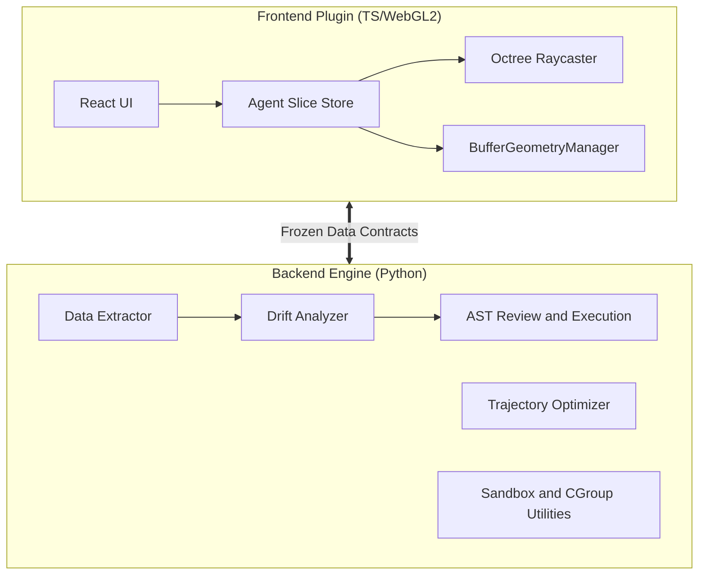

<div align="center">

# 🚀 Alignment Engine

**A Multi-Agent Visual Analytics & Alignment Pipeline**

[](https://github.com/hnuDeng/Alignment_Engine/actions/workflows/ci.yml)
[](#)
[](#)
[](https://opensource.org/licenses/MIT)

[Features](#-features) •
[Architecture](#-architecture) •
[Installation](#-installation) •
[Quick Start](#-quick-start) •
[Development](#-development--testing)

</div>

---

## 📖 Overview

**Alignment Engine** is a pipeline for multi-agent visual analytics and Large Language Model (LLM) alignment data exploration. It includes a **Python backend** for data extraction, drift analysis, trajectory optimization, and script review, plus a **TypeScript/WebGL frontend** with React components for a FiftyOne host.

Data contracts use Pydantic, the frontend enables strict TypeScript checks, and numerical routines use NumPy. Some optional integrations provide mock or fallback paths; available behavior depends on the installed dependencies and host environment.

## ✨ Features

- **🛡️ Typed Data and Script Review**: Pydantic data contracts and AST-based script checks, with separate sandbox and cgroup utilities. Deployment isolation requires the corresponding runtime configuration.
- **⚡ Vectorized Drift Analysis**: NumPy-based embedding distance and threshold calculations, with a CUDA path when available. Work scales with the number and dimensions of the input embeddings.
- **🚀 Trajectory Optimization**: NumPy-based finite-difference routines for multi-agent routing.
- **🌌 WebGL Rendering**: `BufferGeometryManager` and octree raycasting support embedding visualization and point selection. Performance depends on the dataset and hardware.
- **🧩 Fallback Paths**: Mock sample extraction and NumPy analysis support local use when FiftyOne or CUDA is unavailable.

## 🏗️ Architecture

The project contains backend and frontend subsystems:



## 📦 Installation

Ensure you have **Python 3.11+** and **Node.js 24** installed (the versions used by CI). The locked frontend test dependencies require at least Node.js 22.

### 1. Clone the repository
```bash
git clone https://github.com/hnuDeng/Alignment_Engine.git
cd Alignment_Engine
```

### 2. Setup the Backend
```bash
cd alignment-engine
python -m venv venv
source venv/bin/activate
python -m pip install -r requirements.txt
```

On Windows PowerShell, activate the environment with `.\venv\Scripts\Activate.ps1` instead of `source`. The requirements include optional integrations such as FiftyOne, Docker, Ray, and Transformers.

### 3. Setup the Frontend
```bash
cd ../frontend_plugin
npm ci
```

## 🚀 Quick Start

Run the following commands from the repository root in separate terminals. The backend entry point runs the analysis pipeline with script execution in dry-run mode:

```bash
# Terminal 1: Run the backend analysis pipeline
cd alignment-engine
python main.py
```

```bash
# Build the frontend component/plugin library
cd frontend_plugin
npm run build
```

The frontend build emits JavaScript and type declarations to `frontend_plugin/dist`. Embed the exported `AgentCopilotPanel` in your FiftyOne host; this package does not define a standalone development server.

## 🧪 Development & Testing

CI runs backend tests, frontend tests, TypeScript checking, and the frontend build. Coverage must be measured locally; the optional frontend coverage command enforces the thresholds in `frontend_plugin/jest.config.js`.

**Run Backend Tests (Pytest):**
```bash
cd alignment-engine
python -m pip install pytest-cov
python -m pytest --cov=core --cov-report=term
```

**Run Frontend Tests (Jest):**
```bash
cd frontend_plugin
npm test
npm run typecheck
npm run build
npm run test:coverage
```

The concurrent fuzzing test exercises mock reviewer and analyzer implementations; passing it does not verify real sandbox isolation.

## 🤝 Contributing

We welcome contributions! Please follow our rigorous commit standard:
1. **Never use placeholders** (e.g., `pass`, `# TODO`).
2. Maintain strong typing across boundaries.
3. Include unit tests for every new branch of logic.
4. Open a PR with detailed benchmarks if modifying the `analyzer` or `trajectory_optimizer`.

## 📜 License

This project is licensed under the [MIT License](LICENSE).
