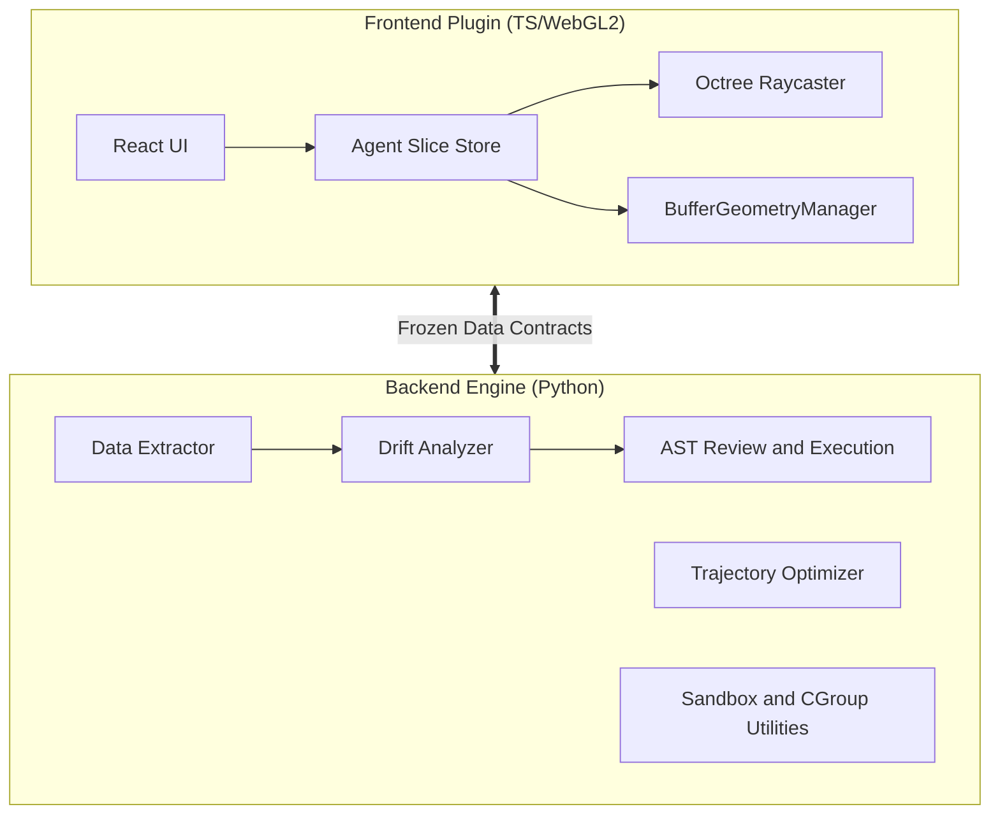

<div align="center">

# 🚀 Alignment Engine

**A Multi-Agent Visual Analytics & Alignment Pipeline**

[](https://github.com/hnuDeng/Alignment_Engine/actions/workflows/ci.yml)
[](#)
[](#)
[](https://opensource.org/licenses/MIT)

[Features](#-features) •
[Architecture](#-architecture) •
[Installation](#-installation) •
[Quick Start](#-quick-start) •
[Development](#-development--testing)

</div>

---

## 📖 Overview

**Alignment Engine** is a pipeline for multi-agent visual analytics and Large Language Model (LLM) alignment data exploration. It includes a **Python backend** for data extraction, drift analysis, trajectory optimization, and script review, plus a **TypeScript/WebGL frontend** with React components for a FiftyOne host.

Data contracts use Pydantic, the frontend enables strict TypeScript checks, and numerical routines use NumPy. Some optional integrations provide mock or fallback paths; available behavior depends on the installed dependencies and host environment.

## ✨ Features

- **🛡️ Typed Data and Script Review**: Pydantic data contracts and AST-based script checks, with separate sandbox and cgroup utilities. Deployment isolation requires the corresponding runtime configuration.
- **⚡ Vectorized Drift Analysis**: NumPy-based embedding distance and threshold calculations, with a CUDA path when available. Work scales with the number and dimensions of the input embeddings.
- **🚀 Trajectory Optimization**: NumPy-based finite-difference routines for multi-agent routing.
- **🌌 WebGL Rendering**: `BufferGeometryManager` and octree raycasting support embedding visualization and point selection. Performance depends on the dataset and hardware.
- **🧩 Fallback Paths**: Mock sample extraction and NumPy analysis support local use when FiftyOne or CUDA is unavailable.

## 🏗️ Architecture

The project contains backend and frontend subsystems:



## 📦 Installation

Ensure you have **Python 3.11+** and **Node.js 24** installed (the versions used by CI). The locked frontend test dependencies require at least Node.js 22.

### 1. Clone the repository
```bash
git clone https://github.com/hnuDeng/Alignment_Engine.git
cd Alignment_Engine
```

### 2. Setup the Backend
```bash
cd alignment-engine
python -m venv venv
source venv/bin/activate
python -m pip install -r requirements.txt
```

On Windows PowerShell, activate the environment with `.\venv\Scripts\Activate.ps1` instead of `source`. The requirements include optional integrations such as FiftyOne, Docker, Ray, and Transformers.

### 3. Setup the Frontend
```bash
cd ../frontend_plugin
npm ci
```

## 🚀 Quick Start

Run the following commands from the repository root in separate terminals. The backend entry point runs the analysis pipeline with script execution in dry-run mode:

```bash
# Terminal 1: Run the backend analysis pipeline
cd alignment-engine
python main.py
```

```bash
# Build the frontend component/plugin library
cd frontend_plugin
npm run build
```

The frontend build emits JavaScript and type declarations to `frontend_plugin/dist`. Embed the exported `AgentCopilotPanel` in your FiftyOne host; this package does not define a standalone development server.

### Offline WebSocket verification

With Python, NumPy, Pydantic, websockets, pytest, Node.js and the existing frontend `node_modules` already installed, run these commands from the repository root in PowerShell. No installation or download is needed:

```powershell
Set-Location alignment-engine
python server.py --offline
```

This listens on `ws://localhost:8765`, extracts local mock records and uses NumPy without launching FiftyOne or trying CUDA. Stop it with Ctrl+C. In another terminal, run the deterministic cross-language test and the full checks:

```powershell
Set-Location alignment-engine
python -m pytest
Set-Location ../frontend_plugin
npm test -- --runInBand
$env:ALIGNMENT_LIVE_PYTHON = "1"
npm test -- --runInBand tests/hooks/websocketProtocol.test.tsx
Remove-Item Env:ALIGNMENT_LIVE_PYTHON
npm run typecheck
npm run build
```

The normal Jest suite uses a captured Python wire fixture and does not require Python dependencies in the frontend job. The additional `ALIGNMENT_LIVE_PYTHON=1` run invokes `python` from `PATH`, which must have the existing backend dependencies. It sends deterministic fixture embeddings through the real NumPy analyzer and Python handler, then feeds the serialized messages to the React hook and alert. A separate Python test exercises a loopback WebSocket. The fixture and mock records are synthetic; this does not validate a FiftyOne host, CUDA, model quality, or an external service.

Messages use lowercase `stream_start`, `drift_report`, `stream_end`, `heartbeat`, and `error`, with a per-connection increasing `seq` and a `payload`. The client also accepts uppercase message names. It ignores malformed, duplicate and out-of-order messages. Clients send `{"type":"heartbeat"}`; the server replies with a sequenced heartbeat and reports malformed or unsupported inputs as errors. Reconnection starts a new sequence and a new analysis; replay or incremental synchronization is not provided. The server sends a generic error and an end message if analysis fails.

The report's `centroidDistance` is the analyzer's per-sample Euclidean distance, and `meanDistance` and `threshold` are its aggregate statistics. `totalSamples` counts records in the extracted slice, and the legacy wire field `driftCount` counts selected candidates, not confirmed anomalies. The analyzer fills its minimum selection with the highest-distance samples when fewer exceed the threshold, so selection alone does not prove that every sample crossed it. Both distances and thresholds are rounded in the report; comparisons near equality cannot reliably recover the analyzer's original decision. The panel labels these as candidates, and the normalized store leaves their drift classification and aggregate count unavailable. `isolationScore` and `severity` are `null` because this analyzer does not compute them; the alert displays them as unavailable. `source` identifies mock data, and `mock_numpy` identifies the NumPy path. Mock embeddings use a fixed seed, but generated IDs and timestamps vary between runs.

For legacy `drift_event` messages without report metadata, the panel identifies the timestamp as local receipt time and the analysis mode as unavailable. Server error messages remain visible independently of the connection indicator; a subsequent heartbeat does not erase the error. A new stream clears the previous server error.

## 🧪 Development & Testing

CI runs backend tests, frontend tests, TypeScript checking, and the frontend build. Coverage must be measured locally; the optional frontend coverage command enforces the thresholds in `frontend_plugin/jest.config.js`.

**Run Backend Tests (Pytest):**
```bash
cd alignment-engine
python -m pip install pytest-cov
python -m pytest --cov=core --cov-report=term
```

**Run Frontend Tests (Jest):**
```bash
cd frontend_plugin
npm test
npm run typecheck
npm run build
npm run test:coverage
```

The concurrent fuzzing test exercises mock reviewer and analyzer implementations; passing it does not verify real sandbox isolation.

## 🤝 Contributing

We welcome contributions! Please follow our rigorous commit standard:
1. **Never use placeholders** (e.g., `pass`, `# TODO`).
2. Maintain strong typing across boundaries.
3. Include unit tests for every new branch of logic.
4. Open a PR with detailed benchmarks if modifying the `analyzer` or `trajectory_optimizer`.

## 📜 License

This project is licensed under the [MIT License](LICENSE).
